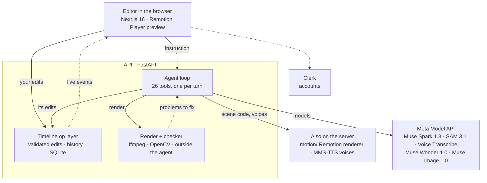
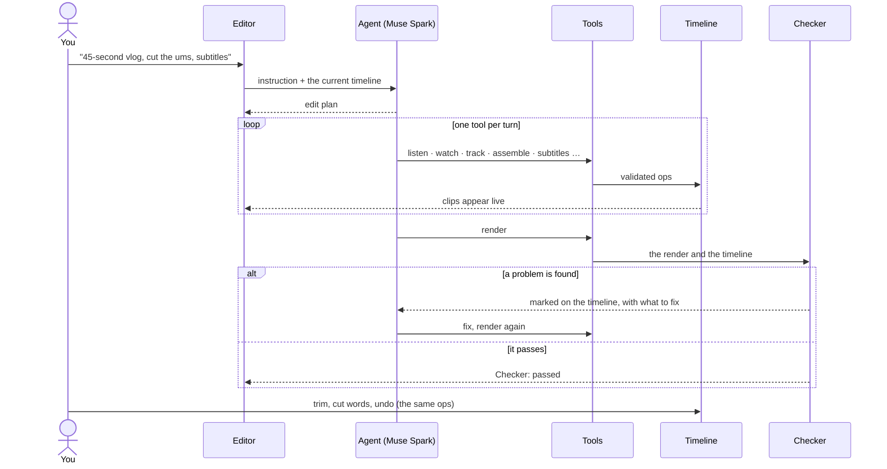
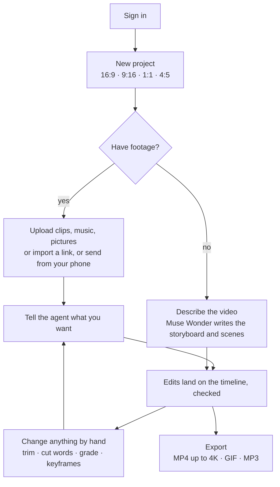

# Auteur Labs

**A video editor you can talk to.** Upload raw footage and direct it like you would a human editor: "a 45-second vertical vlog, open with the best moment, cut the ums, blur every face except hers." An agent built on Meta's models watches and listens to the footage, edits a real timeline you can still change by hand, and has every render checked before you see it. No footage at all? Describe the video and Muse Wonder writes it as code.

[](https://cerebralvalley.ai/e/meta-ai-developer-hackathon)
**Problem statement:** Build for Your World · **Track:** Indie Developer

Everything in this repository was built during the hackathon's building period (Oct 27 – Nov 4, 2026). What was written for Auteur and what was used as-is: [Built during the hackathon](#built-during-the-hackathon).

| | |
| --- | --- |
| **Live demo** | [auteurlabs.xyz](https://auteurlabs.xyz) |
| **Demo video** | [youtu.be/r3cgEqTdivk](https://youtu.be/r3cgEqTdivk) |
| **Product spec** | [docs/PRD.md](docs/PRD.md) |
| **Deploy guide** | [docs/DEPLOY.md](docs/DEPLOY.md) |

### Try it (no credentials needed)

Sign-up on the live demo is open: you create your own account in a few seconds, so there are no shared logins or passwords.

1. Open **[auteurlabs.xyz](https://auteurlabs.xyz)** → **Start my first edit** → continue with **Google** or an email address.
2. **Fastest first run, no footage needed:** pick the **Launch video in code** recipe, describe a product, and Muse Wonder writes and renders the video scene by scene (about 2–3 minutes).
3. **With footage:** upload a phone clip (or paste a direct video link from Pexels or Pixabay with **Link**) and direct it, for example: *"Make a 30-second vertical video, open with the best moment, cut the ums, add subtitles, warm look."* The agent's steps appear live and land on the timeline, which you can then edit by hand.
4. Every account includes **$5 of Meta Model API usage**, enough for several runs; the cost of each run is shown live in the top bar.

Prefer not to sign up? Watch the [demo video](https://youtu.be/r3cgEqTdivk) and the three projects below, or run Auteur on your own machine with your own Meta API key ([Setup](#setup)).

### Made with Auteur

The three projects from the demo, exported straight from the editor:

| Project | What the agent was asked | Result |
| --- | --- | --- |
| **A day in my life** | Nine raw scenes and an outro: put them in order, cut the bloopers and long pauses, louder voices, small subtitles, royalty-free lofi songs from Pixabay under three scenes and the outro | [Watch](https://youtu.be/PuKbFWEiAk0) |
| **Blur the crowd** | Concert footage: blur every face in the crowd except one person, leave the performers on stage alone, add subtitles | [Watch](https://youtube.com/shorts/5NV5aGALMV8) |
| **Launch video in code** | No footage: a 30-second launch video for Auteur, written scene by scene by Muse Wonder | [Watch](https://youtu.be/j5qsV9Zt60c) |

### For judges

| Criterion | Where to look |
| --- | --- |
| **Impact** | Anyone with phone footage gets a post-ready video by describing it. In a measured run, 88 seconds of raw clips became a 30-second vertical vlog in 167 seconds, for $0.53 in Meta API calls. Try it yourself: [Try it](#try-it-no-credentials-needed) |
| **Use of Meta AI tooling** | Five Meta models through the Meta Model API plus Meta's open MMS-TTS weights, each doing work a basic integration doesn't: [Beyond a basic integration](#beyond-a-basic-integration) |
| **Technical depth & execution** | One op layer for the agent and the user, a preview that matches the export (parity and pixel tests), a checker outside the agent, sandboxed model-written code, 268 tests: [Architecture](#architecture), [Engineering notes](#engineering-notes) |
| **Demo** | The [live demo](https://auteurlabs.xyz) with open sign-up, the [3-minute video](https://youtu.be/r3cgEqTdivk) and [three finished projects](#made-with-auteur) |
| **Best Agentic Use-Case** | The agent plans a multi-step edit, calls 26 tools one per turn, and after every render a checker it can't influence sends problems back for it to fix: [An instruction, start to finish](#an-instruction-start-to-finish) |
| **Best Creative Build** | Muse Wonder writes whole videos as Remotion code and reviews frames of its own render; Muse Image paints shots that weren't filmed: [the launch video](https://youtu.be/j5qsV9Zt60c) |

---

## The problem

Editing a short video from raw clips takes hours: finding the moments, cutting the ums and false starts, subtitles, color, a vertical version, blurring strangers. AI editors today work from the transcript, so they know what was said but not who is on screen, where they are or what happens. And most hand back a finished file you can't open up and fix.

Auteur is for the people who film their lives, products and events on a phone and never find the hours to edit: creators, small businesses, anyone posting short video. I'm one of them. I film my days all the time, and the clips stay on my phone because editing is the part I never get to. With Auteur you describe the video you want, the agent does the work an editor would, and you keep a timeline you can change.

## What makes Auteur different

- **It sees what's on screen.** Besides the transcript, the agent looks at frames (Muse Spark) and tracks people and objects frame by frame (SAM 3.1). It can keep one subject in a vertical crop, blur every face but one, or cut a background out without a green screen.
- **It edits a real timeline.** Every agent action is a small, validated edit on the timeline the editor shows. Clips slide into place live, you can trim or move anything yourself, and the agent continues from your changes. One history holds both of you, and each instruction undoes as a whole.
- **It writes video as code.** With no footage, Muse Wonder writes a storyboard, then each scene as a Remotion component; each scene is rendered, checked against frames of its own render and fixed, then lands on the same timeline as any clip.
- **Its work is checked.** After every render, a checker outside the agent's control verifies length, format, that the followed subject stays in frame, that blurred faces don't leak, that the grade doesn't burn highlights and that cuts stay on the beat. Problems are marked on the timeline and sent back to the agent to fix.

## Features

**The agent** (26 tools, one per turn)

| Area | What it does |
| --- | --- |
| Understanding footage | Plans the edit; transcribes speech; describes scenes from sampled frames; tracks people, faces and objects |
| Cutting | Assembles the story; removes fillers, false starts and long pauses; freeze frames; any timeline edit |
| Visuals | Subject-following reframe for 9:16 / 1:1 / 4:5; tracked blur or highlight; background removal; color looks or matching a reference image; zoom, speed ramps, transitions, B-roll, cinematic finish |
| Sound and text | Music with ducking; cuts on the beat; karaoke subtitles; translation; voice-overs |
| Generated | Storyboards and scenes in code (Muse Wonder); pictures (Muse Image) |
| Results | Render, then the automatic checker |

**The editor**

| Area | What you get |
| --- | --- |
| Media | Video, audio, pictures and GIFs; import from a link; upload from your phone by QR; up to 10 minutes of footage per project |
| Timeline | Split, trim, move, duplicate; linkage (text and B-roll follow their clip); extra rows for overlapping items; frame stepping |
| Canvas | Move, scale, rotate and flip on the preview; free crop; fit over a blurred or colored backdrop; keyframes for position, scale, rotation and opacity; entrance and exit animations |
| Transitions | Crossfade, dips, slides, wipes, circle, zoom |
| Speed | Slow motion, fast, speed ramps, reverse, freeze frame |
| Color | Exposure through split toning, eight looks, LOG profiles, `.cube` LUTs with intensity, matching a reference image |
| Text | Eight fonts, outline, shadow, background box, seven presets, karaoke subtitles, word-by-word animation |
| Sound | Ducking, fades, volume keyframes, detach audio, waveforms, noise reduction and clearer voice |
| Overlays | B-roll anywhere on the frame, opacity, seven blend modes, chroma key |
| AI in the editor | Edit by deleting words from the transcript; generate a picture; voice-over from text; translate subtitles; dub into 15 languages; remove a background |
| Video in code | A storyboard panel to edit scenes, reorder them and rebuild one at a time |
| Export | MP4 from 480p to 4K (quality presets or a bitrate), GIF, MP3; 24–60 fps; runs in the background with progress and cancel |

**The platform:** accounts with Clerk (Google or email); projects private to their owner; the Meta API cost of every run shown live; per-account and server-wide spending caps.

## How it uses Meta's models

| Model | Role in Auteur |
| --- | --- |
| **Muse Spark 1.3** | The agent: plans and calls one tool per turn through the Responses API. Reads sampled frames to describe scenes, pick moments and choose looks. Translates subtitles |
| **SAM 3.1** (video) | Tracks people, faces, plates and objects for reframing, blur, highlight and the checker; pixel masks for background removal |
| **Muse Voice Transcribe** | What is said: subtitles, cutting fillers and false starts, editing by words, choosing moments |
| **Muse Wonder 1.0** | Videos in code: the storyboard, then each scene as a Remotion component; looks at frames of its own render and fixes clipped or overlapping text |
| **Muse Image 1.0** | Pictures from a prompt in the project's aspect ratio, for shots you didn't film |
| **MMS-TTS** (Meta open weights) | Voice-overs and dubbing in 15 Latin-script languages, run on the server's CPU |

Every run shows its Meta Model API cost live in the editor.

### Beyond a basic integration

- **Muse Spark watches, plans and is held to account.** It reads up to 48 time-labelled frames per clip to choose moments and looks, drives 26 tools one turn at a time, and answers to a checker it can't influence: problems in a render come back as instructions, and it fixes them on its own.
- **SAM 3.1 tracks through a crowd.** Its 16 object IDs are per request, so in a crowd they run out on passers-by. Auteur tracks in parallel 5-second segments and stitches identities across them by box overlap, which took subject coverage on our test clip from 53% to 83%. The same tracks drive subject-following vertical crops, blur on every face but one, and the checker's framing test.
- **SAM 3.1 masks replace a green screen.** Per-frame pixel masks of the subject become an alpha channel at full resolution, so a messy background turns into a blur or a color with no green screen.
- **Voice Transcribe gets word timing it doesn't return.** The API gives turn-level times; Auteur estimates each word from the streaming partials, aligns it to the audio's energy and snaps cuts to silences (86% of words within 150 ms on our timing fixture), which makes editing by deleting words possible.
- **Muse Wonder reviews its own work.** It writes each scene as a Remotion component, the scene is rendered in a sandbox, and Wonder looks at frames of that render to fix clipped or overlapping text before the scene reaches the timeline.
- **Muse Image fills the gaps in the footage.** Pictures come out in the project's aspect ratio and drop onto the timeline as B-roll.
- **Meta's open MMS-TTS weights speak the translation.** Muse Spark translates the subtitles; MMS-TTS voices each line at its subtitle's time, sped up to fit, over the original sound turned down.

## Architecture



- **One op layer for the agent and for you.** The timeline is one JSON document described by Pydantic models (`api/src/auteur/timeline/`); the editor's TypeScript types are generated from them (`make types`). The agent's tools and the editor's buttons go through the same validated operations, so history, undo and linkage behave the same for both.
- **The preview matches the export.** The browser previews with Remotion Player straight from the timeline JSON; exports are rendered by ffmpeg. Every rule that exists in both (crop, transform, keyframes, transitions, text) is written twice and held together by parity and pixel tests. Heavy previews (reverse, LUT, cleaned sound, removed background, chroma key) are prepared in the background.
- **Scene code is untrusted.** It comes from a model that read user text, so it never runs in the editor's browser. The renderer's headless Chromium runs it behind three layers: a parser-based check (only `react`, `remotion` and a few Remotion packages may be imported; no network, storage, globals or code from strings), shadowed browser globals with Function constructors disabled, and a Content-Security-Policy that blocks every request off the renderer's own server.

### An instruction, start to finish



### Using it



## Engineering notes

From testing the Meta Model API and building on it (details in [docs/PRD.md](docs/PRD.md)):

- **SAM 3.1 needs a proxy.** Full-resolution uploads reset the connection, so SAM always gets a 15 fps, 640 px copy without audio.
- **SAM tracking and Voice Transcribe word timing** are described above in [Beyond a basic integration](#beyond-a-basic-integration). One more finding: control tokens such as `<|speaker_A|>` sometimes leak into the transcript text; they are dropped before word timing, or they take a share of the speech time and push the real words out of place.
- **Phone footage is often variable frame rate and rotated.** Every path takes frames by time or from a constant-rate proxy; a test covers variable-rate, rotated footage through the preview, the SAM proxy and the export.
- **A hung request is retried.** Muse Wonder storyboards normally take 15–20 seconds; a request that isn't answered is retried after 90 seconds instead of waiting out the SDK's 10 minutes.

**Tests:** 268 in total: API (pytest, 175), editor (Vitest, 78), scene renderer (node:test, 15). `make test` runs all three.

## Repository

```
auteur/
├── web/       Next.js editor, landing page, Remotion Player preview   → web/README.md
├── api/       FastAPI: agent, timeline ops, rendering, checker        → api/README.md
├── motion/    Node renderer for scenes made in code (Remotion)
├── deploy/    Caddyfile, nginx alternative, production .env example
└── docs/      PRD.md, DEPLOY.md, DESIGN.md
```

## Tech stack

| Layer | Tech |
| --- | --- |
| Editor | Next.js 16 (App Router), React 19, TypeScript, Tailwind CSS 4, Zustand, Remotion Player 4 (preview), Motion and GSAP (landing page), Phosphor icons |
| API | Python 3.12, FastAPI, Pydantic 2, uvicorn, Server-Sent Events (sse-starlette), SQLite, uv |
| Agent and models | OpenAI Python SDK pointed at the Meta Model API (Responses API): Muse Spark 1.3, Muse Wonder 1.0, Muse Image 1.0, SAM 3.1 with `meta-sam-parser`, Muse Voice Transcribe; MMS-TTS through Hugging Face Transformers on PyTorch (CPU) |
| Video | ffmpeg (render, export, previews), OpenCV and NumPy (tracked effects, color statistics), Pillow (text and pictures) |
| Videos in code | Node 24, Remotion renderer 4 in headless Chromium, acorn (scene code validation) |
| Accounts | Clerk (Google or email) |
| Tests | pytest, Vitest, node:test |
| Deploy | Docker Compose; Caddy or an existing nginx with certbot |

## Setup

**Prerequisites:** Node 24+, Python 3.12 with [uv](https://docs.astral.sh/uv/), ffmpeg on the PATH, a [Meta Model API](https://dev.meta.ai/products/meta-model-api) key, and a free [Clerk](https://dashboard.clerk.com) application (development instance; projects need an account).

1. **Clone and install**
   ```bash
   git clone https://github.com/demigohu/auteur.git
   cd auteur
   make install        # web (npm), api (uv sync), motion (npm)
   ```
2. **Configure the API** in `api/.env` (copied from `api/.env.example`):
   ```env
   META_API_KEY=...                  # Meta Model API
   CLERK_PUBLISHABLE_KEY=pk_test_... # the same key as the editor's
   ```
   The other settings (spending caps, footage budget, export limit) are optional; see [api/README.md](api/README.md).
3. **Configure the editor** in `web/.env.local` (copied from `web/.env.example`):
   ```env
   NEXT_PUBLIC_CLERK_PUBLISHABLE_KEY=pk_test_...
   CLERK_SECRET_KEY=sk_test_...
   ```
4. **Run**
   ```bash
   make dev            # editor on http://localhost:3000, API on http://localhost:8000
   ```
   Sign up at `http://localhost:3000/signup`, create a project and upload a clip. The API reference is at `http://localhost:8000/docs`.

| Command | |
| --- | --- |
| `make test` | All three test suites (API, editor, renderer) |
| `make types` | Regenerate the editor's TypeScript types after changing the timeline models |
| `make api` / `make web` | Run one side only |

The first voice-over or dub downloads a voice model (about 145 MB per language) into the data folder. SAM 3.1, Voice Transcribe and the Muse models are billed per call; every run shows its cost in the editor.

## Deploy

Docker Compose runs the API, the editor and Caddy (automatic HTTPS) on one domain, with the API under `/api` and on an `api.` subdomain. On a server that already runs nginx, an override uses it instead of Caddy. Step by step, including DNS, Clerk production and Google sign-in: [docs/DEPLOY.md](docs/DEPLOY.md).

```bash
cp deploy/.env.example .env           # DOMAIN, Clerk keys, spending caps
cp api/.env.example api/.env          # META_API_KEY
docker compose up -d --build
```

## Built during the hackathon

Every line in this repository was written during the hackathon's building period (Oct 27 – Nov 4, 2026). The git history starts on Nov 1 from an empty `create-turbo` scaffold, removed in the first commit.

| Built for Auteur | Used as-is |
| --- | --- |
| The agent loop and its 26 tools; the timeline model, op layer, history and linkage; the editor (timeline, canvas, inspector, words, storyboard, history); the checker; the ffmpeg render pipeline and the OpenCV effects pass; SAM tracking in stitched segments; background removal from SAM masks; word timing for Voice Transcribe; edit by words; translation and dubbing; videos in code with self-review and the scene sandbox; the landing page; the deployment setup | Meta's models through the Meta Model API; MMS-TTS weights; Remotion and Remotion Player; ffmpeg; OpenCV; Next.js; FastAPI; Clerk; `meta-sam-parser`; fonts from Fontsource and Google Fonts; royalty-free music from Pixabay in the demo videos |

## Roadmap

| Next | Why |
| --- | --- |
| A checker that inspects the rendered pixels for blur leaks | Today it reads the tracking data; looking at the render itself would also catch rendering bugs |
| Faster renders for long, heavily cut timelines | Decode only the part of each source a clip uses, and preview agent renders at 30 fps |
| Pick the subject by clicking it on the preview | SAM 3.1 already accepts box and point prompts; today the agent picks the largest, longest-visible subject |
| A per-project style guide the agent always reads | Subtitle look, brand colors and grade, set once instead of in every instruction |
| Voice instructions and multi-camera sync | Direct the edit by talking; line up clips from several cameras |

## Team

| | |
| --- | --- |
| **demigohu** (solo) | [GitHub](https://github.com/demigohu) · [X](https://x.com/demigohu) · [LinkedIn](https://www.linkedin.com/in/tegaraji/) |
